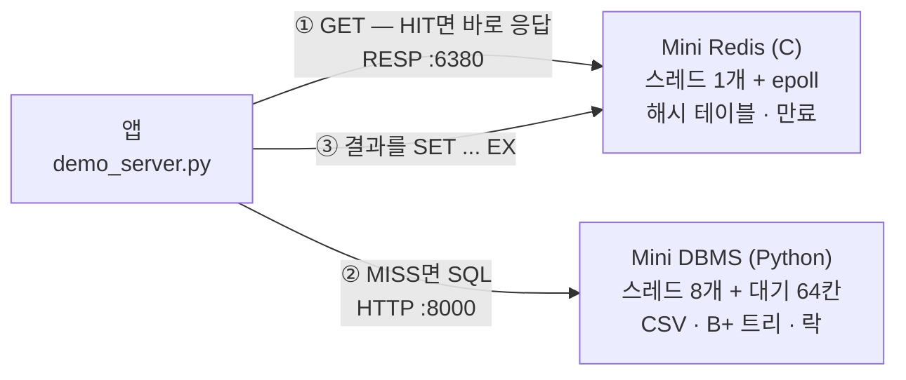

# Jungle7 — Mini DBMS + Mini Redis

크래프톤 정글 SW AI Lab Week 11–12. 파일 기반 **미니 DBMS**(Python)와 해시 테이블 기반 **미니 Redis**(C)를 직접 만들고, Redis를 DBMS 앞의 캐시로 연결했습니다.

[Jungle7-dbms](https://github.com/Jihyun0511/Jungle7-dbms) · [Jungle7-redis](https://github.com/shinyena00/Jungle7-redis) · Jungle7-demo



| 데모에서 확인 | 결과 |
|---|---|
| 이름 조회 | MISS 약 300ms → HIT 약 3ms |
| INSERT 50개 동시 | id 중복 · 누락 없음 |
| `SET k v` (EX 없음) | 거절 |
| 둘째 문장에 문법 오류 | 첫째 문장도 미실행 |

---


## 개발 방식

미니 React 주차에 AI가 요구사항의 빈칸을 대신 정해, 팀이 설명하지 못하는 코드 발생. 이번 주는 **AI가 짠 코드라도 팀이 읽고 책임질 수 있는 것**을 기준으로 진행

1. 각자 Redis · DBMS를 공부하고, 각 서비스의 목적에 따라 꼭 구현돼야 하는 기능을 정의
2. 과제 문서에 정해지지 않은 **빈칸을 찾아 목록화**
3. 입력에 어떤 출력이 나와야 하는지 협의해 테스트 기대값을 먼저 작성 — 정상 동작뿐 아니라 **에러 문구 한 글자, 에러 검사 순서, 경계값**까지
4. 기술 스택과 큰 틀부터 세부 동작까지 결정을 노션에 기록 (후보 → 이유 → 대가 → 남는 구멍)
5. 노션을 AI의 컨텍스트로 넘기고, 세부 알고리즘은 팀원이 각자 구현해 더 효율적인 쪽을 선택해 머지
6. 테스트로 확인한 뒤, 선언형으로 작성된 코드를 위에서부터 읽으며 **팀이 정하지 않은 동작**을 찾아 공유하고 다시 결정

코드를 직접 읽어 둔 덕분에, 문제가 생기면 고칠 위치를 바로 파악 가능

### 팀이 정한 세부 동작 (일부)

DBMS는 결정 **B1~B36**, Redis는 에러 문구 · 검사 순서 · 한도까지 노션에 기록. Redis 테스트는 에러 문구를 **글자 단위까지** 비교

| | 빈칸 | 팀 결정 |
|---|---|---|
| Redis | 만료된 키를 조회하면? | 없는 키와 같은 응답 |
| | SET에 보관 기간이 없으면? | 거절 ("보관 기간이 필요합니다") |
| | 음수 기간은? (진짜 Redis는 명령마다 다르게 동작) | `-1`은 SET · EXPIRE 모두 영구로 통일 |
| | 없는 키를 DEL하면? | 에러 ("없는 키입니다") |
| | 키 · 값 크기 한도는? | 후보 3개 비교 후 키 256B · 값 1MB, 본문을 받기 전에 거절 |
| | 에러가 여러 개 겹치면? | 검사 순서를 1~7로 고정 |
| | 응답을 안 읽는 클라이언트는? | 미전송 응답 4MB 초과 시 연결 종료 |
| DBMS | 여러 문장 중 문법 오류가 있으면? | 전부 미실행 |
| | 실행 중 에러가 나면? | 그 자리에서 중단, 앞 문장은 유지 |
| | 사용자가 id를 직접 넣으면? | 거절 (id는 자동 부여) |
| | 타입이 다른 값은? | 엄격 검사 (int 칸에는 int만) |
| | 에러 메시지 형식은? | `error: statement 2 (line 2, column 32): age is int but got string 'x'` |
| | HTTP 응답 코드는? | 400 SQL 에러 · 500 내부 오류(상세 숨김) · 503 과부하 · 404 · 405 · 403 |

### 팀 공용 규칙 (`CLAUDE.md`)

세 명이 각자 AI를 써도 같은 모양의 코드가 나오도록 **코드 컨벤션을 통일**하고, AI가 작업할 때마다 읽는 규칙 파일(`CLAUDE.md`)로 팀이 함께 관리

- 테스트 파일과 팀이 정한 공개 함수 모양은 **AI 수정 금지**
- **선언형으로 작성**: 공개 함수는 단계 목록처럼 읽히게 하고, 부르는 함수 바로 아래에 그 도우미 배치 (위에서 아래로 읽으면 큰 흐름 → 세부)
- 주석에는 **"왜"와 규칙 번호**(`B13`, `R1` …)만 작성
- 커밋 메시지 형식 통일, 커밋 전 테스트 실행

**토큰 사용량을 추적해 팀원별 AI 사용 방식 비교**

질문(파일을 건드리지 않은 턴)과 구현(파일 생성 · 수정이나 명령 실행이 있었던 턴)으로 나눠, 프로젝트별 비용과 질문 비중을 비교

| 팀원 | 프로젝트 | 합계 비용 | 질문 비용 | 구현 비용 | 질문 비중 | 세션 · 턴 |
|---|---|---:|---:|---:|---:|---|
| 도현 | Redis | $18.41 | $14.11 | $4.30 | 77% | 토큰 8,864만 (질문 6,792만 · 구현 2,072만) |
| 도현 | DBMS | $21.33 | $17.48 | $3.85 | 82% | 토큰 8,281만 (질문 6,787만 · 구현 1,494만) |
| 지현 | Redis | $54.47 | $17.40 | $37.07 | 32% | 세션 1개 · 질문 25턴 · 구현 37턴 |
| 지현 | DBMS | $40.64 | $17.87 | $22.77 | 44% | 세션 1개 · 질문 28턴 · 구현 35턴 |
| 예나 | Redis | $37.99 | $10.99 | $27.00 | 29% | 세션 13개 · 질문 114턴 · 구현 47턴 |
| 예나 | DBMS | $27.77 | $9.14 | $18.63 | 33% | 세션 15개 · 질문 81턴 · 구현 37턴 |

> 비용은 API 정가로 환산한 비교용 금액 (구독 요금제의 실제 청구액 아님). 질문 비중은 비용 기준
>
> 
<br>

---

<br>

## 1. 왜 굳이 서버를 거치는가

이 질문 하나를 기준으로 두 서버가 **무엇을 보장해야 하는지** 정하고 설계했습니다.

| | 역할 | 보장 |
|---|---|---|
| **Mini DBMS** | 여러 프로그램이 정답으로 믿고 함께 쓰는 원본 | 동시에 써도 **깨지지 않음** · 디스크를 써도 **느려지지 않음** |
| **Mini Redis** | **여러 앱 서버가 함께 보는** 메모. 느린 원본 앞에서 자주 묻는 답을 대신 줌 | **멈추지 않음** · **낡은 답을 주지 않음** |

---

## 2. Mini DBMS — 깨지지 않게, 그래도 느려지지 않게

여러 프로그램이 정답으로 믿고 함께 쓰는 원본 → 깨지지 않아야 함.
디스크 앞에서 대신 답해 주는 메모 -> 속도가 보장되어야한다.

워커 8개가 파일 하나 · 버퍼 하나 · B+ 트리 하나를 함께 쓰므로, 동시에 가입하면 같은 id를 받을 수 있음 → 락으로 보호

디스크를 읽는 만큼 락을 오래 쥐면 전체가 느려짐 → 팀원들과 락 구간을 최소로 정함

**락은 꼭 필요한 순간에만** (B23 · B25)

| | 락 안 | 락 밖 |
|---|---|---|
| INSERT | 다음 id 정하기 → 버퍼에 쓰기 → 트리 등록 | 파싱 · 값 검사 |
| SELECT | 파일 끝 위치 기억 (id면 트리에서 위치 찾기) | 파일 읽기 · 해석 |

- 파일은 덧붙이기만 하므로 기억한 위치까지는 바뀌지 않음 → 락 밖에서 읽어도 반쪽 행을 보지 않음
- 제외한 안: SELECT 전체를 락으로 감싸기 → 긴 조회 동안 모든 INSERT가 멈춤
- 일부만 반영되지 않게: 여러 문장은 전부 파싱 후 실행, 여러 행은 전부 검사 후 쓰기, 쓰기 실패 시 파일을 이전 길이로 되돌림

**무거운 일이 한 요청에 몰리지 않게**

| 언제 | 하는 일 | 효과 |
|---|---|---|
| 서버 시작 | 파일을 한 번 훑어 B+ 트리 + 다음 id 생성 | 첫 요청이 전체 스캔을 떠안지 않음 (B24) |
| INSERT | 버퍼에 덧붙이기 + 새 행만 트리에 등록 | 10만 행: 매번 열고 닫기 28.51초 → 0.05초 |
| SELECT | 읽기 직전에만 버퍼 flush | 문장마다 flush하면 0.58초 |

---

## 3. Mini Redis — 멈추지 않게, 낡은 답을 주지 않게

**여러 앱 서버가 함께 보는** 메모 → 멈추면 모두가 멈추고, 틀리면 모두가 틀림

**DBMS는 스레드 8개, Redis는 1개 — 기준은 요청 하나가 하는 일의 길이**

| | Mini DBMS | Mini Redis |
|---|---|---|
| 요청 하나의 일 | 길 수 있음 (이름 조회는 10만 행을 훑어 약 300ms) | 짧음 (키 하나로 해시 테이블 칸 하나) |
| 스레드가 하나라면 | 긴 조회 뒤에 짧은 요청까지 줄 섬 | 일이 짧아 줄이 금방 줄어듦 |
| 그래서 | 워커 8개, 넘치면 바로 503 (B34) · 락은 꼭 필요한 구간에만 | 스레드 하나, 락 없음 |

**스레드 하나 + epoll**

- 연결마다 스레드를 두면 해시 테이블 하나에 락이 필요 → 짧은 일보다 락 비용이 더 큼 → 제외
- 데이터가 도착한 연결만 처리하고, 명령을 하나씩 끝까지 실행 → 락이 없고 반쯤 쓰인 값도 없음

**스레드가 하나라서, 한 연결이 붙잡으면 모두 멈춘다 → 붙잡는 경우를 막음**

| 상황 | 대응 |
|---|---|
| 명령을 절반만 보내고 멈춤 | 연결마다 입력 버퍼, 완성된 명령만 실행하고 다음 연결로 |
| 너무 큰 요청 | 키 256B · 값 1MB, 길이만 보고 본문을 받기 전에 거절 |
| 명령을 몰아 보냄 | 한 연결당 한 바퀴 100개까지 |
| 응답을 안 읽음 · 버려진 연결 | 미전송 응답 4MB 초과 시 종료 · 120초 무활동 정리 |
| 테이블이 커짐 | 요청마다 한 칸씩 옮기는 점진적 rehash |

**낡은 답이 계속 남지 않게 — SET은 EX 필수 (진짜 Redis는 선택)**

- 레디스는 원본(DB)이 바뀐 걸 모름 → 원본이 바뀌면 앱이 DEL을 보내야 하고, 깜빡하면 예전 값을 모든 앱 서버에 계속 돌려줌
- 진짜 Redis는 EX 없이 SET하면 영구 저장 → DEL을 깜빡한 값은 지워지지 않고 남음
- 그래서 SET에 보관 기간을 강제 → DEL을 깜빡해도 틀린 값이 남아 있는 시간에 상한이 생김
- 영구로 두려면 EX -1로 명시
- 만료된 키는 없는 키와 같은 응답 → 앱은 DB에서 다시 조회

---

## 4. 무엇을 Redis에 맡기는가

**기준 1. 느린 조회만**

| 조회 | DBMS만 | Redis |
|---|---|---|
| id | B+ 트리, 약 3ms | 불필요 |
| 이름 | 10만 행 선형 탐색, 약 300ms | 두 번째부터 약 3ms |

**기준 2. 보여주기용만. 결정에 쓰는 정보는 항상 DBMS에서 확인**

| | 보여주기 (Redis 가능) | 결정 (DBMS만) |
|---|---|---|
| 쿠폰 | 이름 · 할인율 · 설명 | 이미 사용했는가 |
| **결제** | 상품 정보 · 리뷰 | **이 결제 요청이 이미 처리됐는가** |
| 차단 | 프로필 · 닉네임 | 차단된 사용자인가 |

결제 처리 여부를 Redis에 캐시했다면:

```text
Redis  SET pay:REQ123 pending EX 30                      # "처리 전"이 캐시된 상태
DBMS   INSERT INTO payments VALUES ('REQ123', 'kim');    # 결제 완료
Redis  GET pay:REQ123             → "pending"            # 이 값을 믿으면 중복 결제
DBMS   SELECT * FROM payments WHERE request = 'REQ123';  # 처리 기록이 바로 보임
```

---


<details>
<summary>빠른 시작</summary>

`Jungle7-redis`, `Jungle7-dbms`, `Jungle7-demo`가 같은 폴더에 있다고 가정합니다.

결제 데모를 쓰려면 DBMS를 켜기 **전에** `db/data/payments.csv`를 만들어 둡니다 (서버가 시작할 때 `data/`의 테이블을 엽니다).

```
id:int,request:str,user:str
```

```bash
# 1. Mini Redis — epoll을 쓰므로 Linux/WSL 또는 도커 (Jungle7-demo에서)
docker build -f redis.Dockerfile -t mini-redis ../Jungle7-redis
docker run --rm -p 6380:6380 mini-redis
#    Linux/WSL: cd Jungle7-redis && make server && ./mini-redis

# 2. Mini DBMS — free-threaded Python 3.14t 권장 (Jungle7-demo/db에서)
cd db
py -3.14t ../../Jungle7-dbms/server.py    # --port 8000 --workers 8 --queue-size 64

# 3. 데모 앱
py -3.14t demo_server.py                   # http://127.0.0.1:8080
```

</details>

<details>
<summary>사용법</summary>

**Mini DBMS** — `POST /query` 본문에 SQL을 그대로 보냅니다. 여러 문장을 한 번에 보낼 수 있습니다.

```bash
curl -X POST http://127.0.0.1:8000/query \
  --data "INSERT INTO users VALUES ('yena', 24); SELECT * FROM users WHERE id = 1;"
```

```json
{"results": [
  {"affected": 1},
  {"columns": ["id", "name", "age"], "rows": [[1, "yena", 24]]}
]}
```

| 지원 문법 | 비고 |
|---|---|
| `INSERT INTO t [(cols)] VALUES (...), (...);` | id는 자동 부여 (직접 넣으면 에러) |
| `SELECT * \| cols FROM t [WHERE col = value];` | `WHERE id = ?`는 B+ 트리, 그 외는 선형 탐색 |

| 상태 코드 | 의미 |
|---|---|
| 200 | 성공 |
| 400 | SQL 에러 (`error` 필드, 앞 문장 결과 포함) |
| 500 | 내부 오류 (상세 숨김) |
| 503 | 워커 · 대기 줄이 가득 참, 또는 종료 중 |

그 외 404 · 405 · 403. 에러 메시지 형식: `error: statement 2 (line 2, column 32): age is int but got string 'x'`

CLI: `python sql_processor.py input.sql`

**Mini Redis** — RESP(TCP, 기본 `127.0.0.1:6380`). 환경 변수 `MINI_REDIS_BIND`, `MINI_REDIS_PORT`. 진짜 Redis와 같은 규격이라 `redis-cli`를 그대로 쓸 수 있습니다.

| 명령 | 응답 |
|---|---|
| `SET key value EX 초` | `OK` · EX 없음 → `보관 기간이 필요합니다` · `EX -1`은 영구 |
| `GET key` | 값, 없거나 만료면 nil |
| `DEL key` | `OK` · 없으면 `없는 키입니다` |
| `EXPIRE key 초` | `OK` · `-1`이면 영구로 · 없으면 `없는 키입니다` |

```bash
redis-cli -p 6380 SET user:name:kim hello EX 30   # OK
redis-cli -p 6380 GET user:name:kim               # "hello"
```

</details>

<details>
<summary>테스트</summary>

```bash
# Mini DBMS
cd Jungle7-dbms && py -3.14t -m pytest

# Mini Redis
cd Jungle7-redis/tests && make unit
MINI_REDIS_PORT=6380 make e2e        # 서버 먼저 실행
```

| 보장 | 테스트 |
|---|---|
| 문법 오류 시 전부 미실행 · 여러 행은 전부 검사 후 쓰기 | DBMS `c6`, `e6` |
| 동시 INSERT에도 id 중복 없음 (락 전 실패 확인) | DBMS `t2` |
| 테이블은 한 번만 열기 | DBMS `t3`, `t3b` |
| 반쪽 행 미노출 · 읽는 동안에도 INSERT 진행 | DBMS `t4`, `t5` |
| 과부하 시 503 · 종료 시 버퍼 flush | DBMS `v9`, `v10`, `v12` |
| 같은 키 동시 접근에도 값 섞임 없음 | Redis `e25`, `e26` |
| 1바이트씩 보내도 명령 조립 · 느린 클라이언트에 다른 요청이 막히지 않음 | Redis `e22`, `e27` |
| 본문 수신 전 큰 요청 거절 | Redis `e15`, `e16`, `e31`, `e33`–`e36` |
| EX 필수 · 잘못된 값 거절 · 거절 시 원래 값 유지 | Redis `e06`, `e07`, `e32` |
| 만료 후 없는 키와 같은 응답 | Redis `u11`–`u13`, `e08` |

</details>

<details>
<summary>디렉터리 구조</summary>

```
Jungle7-dbms/
  server.py · sql_processor.py      진입점 (API 서버 · CLI)
  minidb/  tokenizer → parser → engine → storage (+ bptree) · server
  tests/   단위 · 기능 · 동시성(t1–t5) · 서버(v1–v14)

Jungle7-redis/
  src/     server.c (이벤트 루프) · resp.c (프로토콜) · command.c · store.c (해시 테이블)
  include/ store.h · resp.h · command.h
  tests/   unit (u1–u18) · e2e (e1–e36)

Jungle7-demo/
  demo_server.py · index.html · redis.Dockerfile · db/data/
```

</details>
