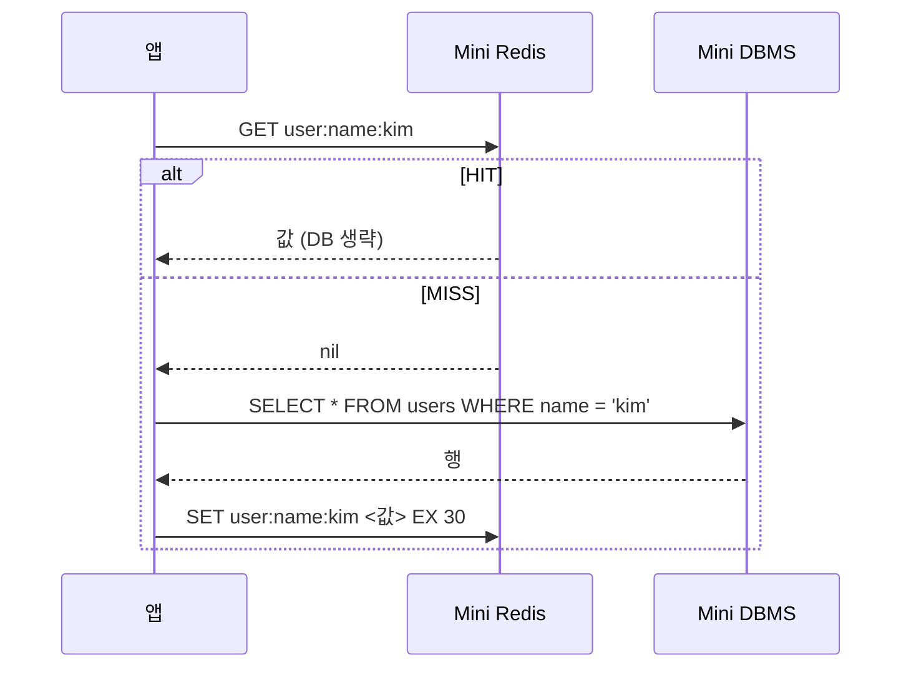

# Jungle7 — Mini DBMS + Mini Redis

크래프톤 정글 SW AI Lab Week 11–12. 파일 기반 **미니 DBMS**(Python)와 해시 테이블 기반 **미니 Redis**(C)를 직접 구현하고, Redis를 DBMS 앞의 캐시로 연결

- [Jungle7-dbms](https://github.com/Jihyun0511/Jungle7-dbms) — SQL 처리기 · B+ 트리 인덱스 · 스레드 풀 API 서버
- [Jungle7-redis](https://github.com/shinyena00/Jungle7-redis) — RESP 키-값 저장소 · 만료 · 이벤트 루프 서버

---

## 개요

파일에 직접 쓰거나 파이썬 딕셔너리에 넣으면 더 간단한데, 굳이 서버를 만들어 거쳐 쓰는 이유는 무엇이고, 그렇다면 각 서버는 무엇을 보장해야 하는가. 이 질문을 기준으로 설계

| | 하는 일 | 보장하는 것 | 구조 |
|---|---|---|---|
| **Mini DBMS** | 여러 프로그램이 같은 데이터를 정답으로 믿고 함께 쓰는 원본 | 동시에 써도 **깨지지 않음**, 디스크를 쓰면서도 **느려지지 않음** | HTTP · 스레드 8개 · 테이블 락 · CSV + B+ 트리 |
| **Mini Redis** | 느린 원본 앞에서 자주 묻는 답을 대신 빨리 주는 메모 | **멈추지 않음**, **낡은 답을 주지 않음** | RESP(TCP) · 스레드 하나 + epoll · 락 없음 · 해시 테이블 |

```
                  ┌──────────────── 앱 (demo_server.py) ────────────────┐
                  │  1. Redis에 묻는다  →  HIT면 바로 응답               │
                  │  2. MISS면 DBMS에 SQL  →  결과를 Redis에 저장(EX)    │
                  └───────────┬───────────────────────────┬────────────┘
                         RESP │ :6380                HTTP │ :8000
                  ┌───────────▼──────────┐    ┌───────────▼──────────────┐
                  │ Mini Redis (C)        │    │ Mini DBMS (Python)        │
                  │ 스레드 하나 + epoll    │    │ 스레드 8개 + 대기 64칸     │
                  │ 해시 테이블 · 만료      │    │ CSV 파일 · B+ 트리 · 락    │
                  └──────────────────────┘    └──────────────────────────┘
```

---

## 개발 방식

미니 React 주차에 AI가 요구사항의 빈칸을 대신 정해, 팀이 설명하지 못하는 코드 발생. 이번 주는 **AI가 짠 코드라도 팀이 읽고 책임질 수 있는 것**을 기준으로 진행

1. 각자 Redis · DBMS를 공부하고, 각 서비스의 목적에 따라 꼭 구현돼야 하는 기능을 정의
2. 과제 문서에 정해지지 않은 **빈칸을 찾아 목록화**
3. 입력에 어떤 출력이 나와야 하는지 협의해 테스트 기대값을 먼저 작성 — 정상 동작뿐 아니라 **에러 문구 한 글자, 에러 검사 순서, 경계값**까지
4. 기술 스택과 큰 틀부터 세부 동작까지 결정을 노션에 기록 (후보 → 이유 → 대가 → 남는 구멍)
5. 노션을 AI의 컨텍스트로 넘기고, 세부 알고리즘은 팀원이 각자 구현해 더 효율적인 쪽을 선택
6. 테스트로 확인한 뒤, 위에서부터 코드를 읽으며 **팀이 정하지 않은 동작**을 찾아 공유하고 다시 결정

코드를 직접 읽어 둔 덕분에, 문제가 생기면 고칠 위치를 바로 파악 가능

### 팀이 정한 세부 동작 (일부)

DBMS는 결정 **B1~B36**, Redis는 에러 문구 · 검사 순서 · 한도까지 노션에 기록. Redis 테스트는 에러 문구를 **글자 단위까지** 비교

| | 빈칸 | 팀 결정 |
|---|---|---|
| Redis | 만료된 키를 조회하면? | 없는 키와 같은 응답 |
| | SET에 보관 기간이 없으면? | 거절 ("보관 기간이 필요합니다") |
| | 음수 기간은? (진짜 Redis는 명령마다 다르게 동작) | `-1`은 SET · EXPIRE 모두 영구로 통일 |
| | 없는 키를 DEL하면? | 에러 ("없는 키입니다") |
| | 키 · 값 크기 한도는? | 후보 3개 비교 후 키 256B · 값 1MB, 본문을 받기 전에 거절 |
| | 에러가 여러 개 겹치면? | 검사 순서를 1~7로 고정 |
| | 응답을 안 읽는 클라이언트는? | 미전송 응답 4MB 초과 시 연결 종료 |
| DBMS | 여러 문장 중 문법 오류가 있으면? | 전부 미실행 |
| | 실행 중 에러가 나면? | 그 자리에서 중단, 앞 문장은 유지 |
| | 사용자가 id를 직접 넣으면? | 거절 (id는 자동 부여) |
| | 타입이 다른 값은? | 엄격 검사 (int 칸에는 int만) |
| | 에러 메시지 형식은? | `error: statement 2 (line 2, column 32): age is int but got string 'x'` |
| | HTTP 응답 코드는? | 400 SQL 에러 · 500 내부 오류(상세 숨김) · 503 과부하 · 404 · 405 · 403 |

### 팀 공용 규칙 (`CLAUDE.md`)

세 명이 각자 AI를 써도 같은 모양의 코드가 나오도록 **코드 컨벤션을 통일**하고, AI가 작업할 때마다 읽는 규칙 파일(`CLAUDE.md`)로 팀이 함께 관리

- 테스트 파일과 팀이 정한 공개 함수 모양은 **AI 수정 금지**
- **선언형으로 작성**: 공개 함수는 단계 목록처럼 읽히게 하고, 부르는 함수 바로 아래에 그 도우미 배치 (위에서 아래로 읽으면 큰 흐름 → 세부)
- 주석에는 **"왜"와 규칙 번호**(`B13`, `R1` …)만 작성
- **상태를 바꾸기 전에 실패할 수 있는 일을 먼저** 처리 → 에러가 나도 원래 값 유지
- 커밋 메시지 형식 통일, 커밋 전 테스트 실행

**토큰 사용량을 추적해 팀원별 AI 사용 방식 비교**

질문(파일을 건드리지 않은 턴)과 구현(파일 생성 · 수정이나 명령 실행이 있었던 턴)으로 나눠, 프로젝트별 비용과 질문 비중을 비교

| 팀원 | 프로젝트 | 합계 비용 | 질문 비용 | 구현 비용 | 질문 비중 | 세션 · 턴 |
|---|---|---:|---:|---:|---:|---|
| 도현 | Redis | $18.41 | $14.11 | $4.30 | 77% | 토큰 8,864만 (질문 6,792만 · 구현 2,072만) |
| 도현 | DBMS | $21.33 | $17.48 | $3.85 | 82% | 토큰 8,281만 (질문 6,787만 · 구현 1,494만) |
| 지현 | Redis | $54.47 | $17.40 | $37.07 | 32% | 세션 1개 · 질문 25턴 · 구현 37턴 |
| 지현 | DBMS | $40.64 | $17.87 | $22.77 | 44% | 세션 1개 · 질문 28턴 · 구현 35턴 |
| 예나 | Redis | $37.99 | $10.99 | $27.00 | 29% | 세션 13개 · 질문 114턴 · 구현 47턴 |
| 예나 | DBMS | $27.77 | $9.14 | $18.63 | 33% | 세션 15개 · 질문 81턴 · 구현 37턴 |

> 비용은 API 정가로 환산한 비교용 금액 (구독 요금제의 실제 청구액 아님). 질문 비중은 비용 기준

---

## 설계 결정

### Mini DBMS — 깨지지 않게, 느려지지 않게

사용자는 SQL로 **무엇을** 원하는지만 전달하고, **어떻게** 찾을지는 DBMS가 결정 → B+ 트리 인덱스를 추가할 때도 SQL 변경 없음

여러 스레드가 **파일 하나 · 쓰기 버퍼 하나 · B+ 트리 하나**를 공유하므로, 끼어들 수 있는 지점을 막고 락은 꼭 필요한 구간에만 적용

| 위험 | 결정 | 이유 · 대가 |
|---|---|---|
| 동시 INSERT의 id 중복 | **다음 id 정하기 → 버퍼 쓰기 → 트리 등록**만 테이블 락 안에서. 파싱 · 값 검사는 락 밖 | 락을 짧게 유지 |
| 쓰는 중인 반쪽 행 읽기 / 읽는 동안 쓰기 정지 | 락 안에서는 flush 후 **파일 끝 위치만 기억**, 실제 읽기는 **락 밖에서 그 위치까지만** | 파일은 덧붙이기만 하므로 기억한 위치까지는 불변. 대가: 조회 도중 들어온 행은 그 조회에 미포함 |
| 첫 요청들의 같은 테이블 중복 열기 | 테이블 찾기 · 열기는 **엔진 락 안에서 한 번만**, 서버 시작 시 **미리 열기**. 엔진 락과 테이블 락은 동시에 쥐지 않음 | 버퍼 · 트리가 테이블당 하나로 유지, 교착 방지 |
| 요청 일부만 반영 | 여러 문장은 **전부 파싱 후 실행**(문법 오류 시 전부 미실행), 여러 행 INSERT는 **전부 검사 후 쓰기**, 쓰기 실패 시 **파일을 이전 길이로 되돌림**(실패하면 테이블을 고장으로 표시) | 오타 하나로 앞부분만 들어가는 일 방지 |
| 종료 시 버퍼의 행 유실 · 과부하 | 종료 시 처리 중 요청을 기다린 뒤 **버퍼 flush 후 닫기**. 워커 8 + 대기 64가 차면 **즉시 503** | 이미 받은 쓰기 보존 |

**느려지지 않게**

| 결정 | 효과 |
|---|---|
| id → 파일 위치를 B+ 트리에 저장, 해당 위치의 **한 줄만** 읽음 | id 조회는 데이터 양과 거의 무관 |
| 트리 생성 시점: **CLI는 첫 id 조회까지 미룸**, **서버는 시작 시 미리** | CLI의 INSERT 전용 실행은 트리 비용 없음 / 서버 첫 조회가 락을 쥔 채 파일을 훑는 일 없음 |
| 따옴표 없는 행은 csv 해석 없이 쉼표로 잘라 id 추출 | 100만 행 트리 생성 **4.3초 → 2.2초** |

### Mini Redis — 멈추지 않게, 낡지 않게

**구조: 스레드 하나 + epoll, 락 없음**

Redis는 **연결은 많고, 일 하나는 키 하나를 찾는 짧은 일**

| 후보 | 판단 |
|---|---|
| 연결마다 스레드 | 연결 수만큼 스레드 증가, 해시 테이블 공유로 락 필요 → 짧은 일보다 락 · 대기 · 깨우기 비용이 큼 |
| 받는 스레드 여럿 + 실행 스레드 하나 | 스레드 간 요청 · 결과 전달 비용, 연결 끊김 처리 복잡 → 제외 |
| ✅ **스레드 하나 + epoll** | 데이터가 도착한 연결만 처리, 연결이 늘어도 스레드는 하나 |

- 명령 하나를 끝까지 처리한 뒤 다음 명령을 잡으므로 **반쯤 쓰인 값 없음** (락 없이)
- 같은 순서의 요청은 항상 같은 결과 → 버그 재현 가능
- 대가: 스레드 하나를 오래 붙잡으면 전체 정지 → 아래 방법으로 방지

**멈추지 않게**

| 붙잡는 경우 | 결정 |
|---|---|
| 명령을 일부만 보내고 멈춘 클라이언트 | 논블로킹 소켓, 연결별 입력 버퍼(recv 16KB 단위), **완성된 명령만 실행** |
| 너무 큰 요청 | 키 256B · 값 1MB · 단어 5개. RESP 길이 헤더만 보고 **본문을 받기 전에 거절 후 연결 종료** |
| 명령을 몰아 보내는 클라이언트 | 한 연결당 **한 바퀴 100개**, 나머지는 대기 목록으로 |
| 응답을 읽지 않는 클라이언트 · 유휴 연결 | 미전송 응답 **4MB 초과 시 종료**, **120초** 무활동 연결 정리 |
| 테이블 확장 | 8칸 시작, 키 수 = 칸 수면 2배 테이블로 **요청마다 한 칸씩** 이동 (점진적 rehash, 빈 칸은 최대 10개까지 건너뜀) |

**낡지 않게**

| 결정 | 이유 |
|---|---|
| **SET은 `EX` 필수**, 영구는 `EX -1`로 명시. 잘못된 값은 거절하고 원래 값 유지 | 저장하는 쪽이 버릴 시점을 반드시 결정 |
| 저장 시 만료 시각을 기록, **조회 시 비교해 지났으면 삭제하고 없는 키와 같은 응답** | 쓰는 쪽은 "만료"와 "없음"을 구분할 필요 없이 DB로 다시 조회 |
| 메모리 부족으로 버퍼를 못 늘리면 **만료 키 일괄 정리 후 재시도** | 아무도 조회하지 않는 만료 키 정리 |

**외부 사용**: 진짜 Redis와 같은 RESP를 사용해, 기존 Redis 클라이언트를 주소만 바꿔 사용 가능 (`redis-cli`로 SET · GET · DEL 확인)

### 둘의 연결 — 무엇을 Redis에 맡기는가



**기준 1. 느린 조회만 Redis에**

| 조회 | DBMS만 | Redis |
|---|---|---|
| id | B+ 트리, 약 3ms | 불필요 |
| 이름 | 10만 행 선형 탐색, 약 300ms | 두 번째부터 약 3ms |

**기준 2. 보여주기용만 Redis에, 결정에 쓰는 정보는 항상 DBMS에서 확인**

결정에 쓰는 정보가 틀리면 돈이 나가거나 권한이 잘못 주어져, 되돌릴 수 없는 손해 발생

| | 보여주기 (Redis 가능) | 결정 (DBMS만) |
|---|---|---|
| 쿠폰 | 이름 · 할인율 · 설명 | 이미 사용했는가 |
| **결제** | 상품 정보 · 리뷰 | **이 결제 요청이 이미 처리됐는가** |
| 차단 | 프로필 · 닉네임 | 차단된 사용자인가 |

Redis는 앱 밖에 있으므로 여러 앱 서버가 같은 캐시를 공유. Redis는 DB 변경을 알 수 없으므로, 원본이 바뀌면 `DEL`은 앱이 전송 (현재 DBMS는 INSERT · SELECT만 지원해 기존 행 변경 없음)

---

## 데모

`Jungle7-demo`의 테스트 페이지(`http://127.0.0.1:8080`)에서 확인

| 장 | 확인 |
|---|---|
| 1장 | 이름 조회: MISS 약 300ms → HIT 약 3ms. id 조회는 DBMS만으로 약 3ms |
| 2장 | INSERT 50개 동시 → id 중복 · 누락 없음 / 긴 SELECT 중에도 INSERT가 먼저 완료 |
| 3장 | `SET k v` (EX 없음) → 거절 |
| 4장 | 둘째 문장에 문법 오류 → 첫째 문장도 미실행 |

**결제 처리 여부를 Redis에 캐시했다면** (3장 · 4장)

```text
[3장] SET pay:REQ123 pending EX 30                      # "처리 전"이 캐시돼 있다면
[4장] INSERT INTO payments VALUES ('REQ123', 'kim');    # 결제 완료
[3장] GET pay:REQ123             → "pending"            # 이 값을 믿으면 중복 결제
[4장] SELECT * FROM payments WHERE request = 'REQ123';  # 처리 기록이 바로 보임
```

---

## 빠른 시작

`Jungle7-redis`, `Jungle7-dbms`, `Jungle7-demo`가 같은 폴더에 있는 것을 전제

```bash
# 1. Mini Redis — epoll을 쓰므로 Linux/WSL 또는 도커 (Jungle7-demo에서)
docker build -f redis.Dockerfile -t mini-redis ../Jungle7-redis
docker run --rm -p 6380:6380 mini-redis
#    Linux/WSL: cd Jungle7-redis && make server && ./mini-redis

# 2. Mini DBMS — free-threaded Python 3.14t 권장 (Jungle7-demo/db에서)
cd db
py -3.14t ../../Jungle7-dbms/server.py    # --port 8000 --workers 8 --queue-size 64

# 3. 데모 앱
py -3.14t demo_server.py                   # http://127.0.0.1:8080
```

결제 데모는 DBMS를 켜기 **전에** `db/data/payments.csv` 생성 필요 (서버가 시작 시 `data/`의 테이블을 열기 때문)

```
id:int,request:str,user:str
```

---

## 사용법

### Mini DBMS

`POST /query` 본문에 SQL을 그대로 전송. 여러 문장을 한 번에 전송 가능

```bash
curl -X POST http://127.0.0.1:8000/query \
  --data "INSERT INTO users VALUES ('yena', 24); SELECT * FROM users WHERE id = 1;"
```

```json
{"results": [
  {"affected": 1},
  {"columns": ["id", "name", "age"], "rows": [[1, "yena", 24]]}
]}
```

| 지원 문법 | 비고 |
|---|---|
| `INSERT INTO t [(cols)] VALUES (...), (...);` | id는 자동 부여 (직접 넣으면 에러) |
| `SELECT * \| cols FROM t [WHERE col = value];` | `WHERE id = ?`는 B+ 트리, 그 외는 선형 탐색 |

| 상태 코드 | 의미 |
|---|---|
| 200 | 성공 |
| 400 | SQL 에러 (`error` 필드, 앞 문장 결과 포함) |
| 503 | 워커 · 대기 줄이 가득 참, 또는 종료 중 |

CLI로도 실행 가능: `python sql_processor.py input.sql`

### Mini Redis

RESP(TCP, 기본 `127.0.0.1:6380`). 환경 변수 `MINI_REDIS_BIND`, `MINI_REDIS_PORT`.

| 명령 | 응답 |
|---|---|
| `SET key value EX 초` | `OK` · EX 없음 → `보관 기간이 필요합니다` · `EX -1`은 영구 |
| `GET key` | 값, 없거나 만료면 nil |
| `DEL key` | `OK` · 없으면 `없는 키입니다` |
| `EXPIRE key 초` | `OK` · `-1`이면 영구로 · 없으면 `없는 키입니다` |

```bash
redis-cli -p 6380 SET user:name:kim hello EX 30   # OK
redis-cli -p 6380 GET user:name:kim               # "hello"
```

---

## 테스트

```bash
# Mini DBMS
cd Jungle7-dbms && py -3.14t -m pytest

# Mini Redis
cd Jungle7-redis/tests && make unit
MINI_REDIS_PORT=6380 make e2e        # 서버 먼저 실행
```

| 보장 | 테스트 |
|---|---|
| 문법 오류 시 전부 미실행 · 여러 행은 전부 검사 후 쓰기 | DBMS `c6`, `e6` |
| 동시 INSERT에도 id 중복 없음 (락 전 실패 확인) | DBMS `t2` |
| 테이블은 한 번만 열기 | DBMS `t3`, `t3b` |
| 반쪽 행 미노출 · 읽는 동안에도 INSERT 진행 | DBMS `t4`, `t5` |
| 과부하 시 503 · 종료 시 버퍼 flush | DBMS `v9`, `v10`, `v12` |
| 같은 키 동시 접근에도 값 섞임 없음 | Redis `e25`, `e26` |
| 1바이트씩 보내도 명령 조립 · 느린 클라이언트에 다른 요청이 막히지 않음 | Redis `e22`, `e27` |
| 본문 수신 전 큰 요청 거절 | Redis `e15`, `e16`, `e31`, `e33`–`e36` |
| EX 필수 · 잘못된 값 거절 · 거절 시 원래 값 유지 | Redis `e06`, `e07`, `e32` |
| 만료 후 없는 키와 같은 응답 | Redis `u11`–`u13`, `e08` |

---

## 디렉터리 구조

```
Jungle7-dbms/
  server.py · sql_processor.py      진입점 (API 서버 · CLI)
  minidb/  tokenizer → parser → engine → storage (+ bptree) · server
  tests/   단위 · 기능 · 동시성(t1–t5) · 서버(v1–v14)

Jungle7-redis/
  src/     server.c (이벤트 루프) · resp.c (프로토콜) · command.c · store.c (해시 테이블)
  include/ store.h · resp.h · command.h
  tests/   unit (u1–u18) · e2e (e1–e36)

Jungle7-demo/
  demo_server.py · index.html · redis.Dockerfile · db/data/
```
